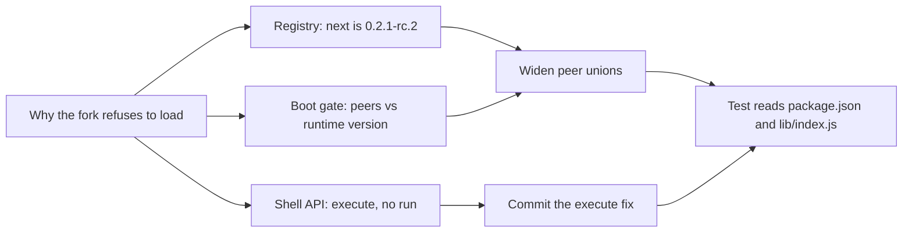

# Peer ranges, prerelease semantics, and the shell API for DSH 0.2.1-rc.2

Research digest: a question answered from cited sources, with what they mean for this work.

<abstract>

DSH `0.2.1-rc.2` is a prerelease of the `next` channel, while the fork's peer unions stop at `0.2.0-rc.2`; under semver's prerelease rules an exact union that omits the installed version cannot match, so the boot compatibility gate refuses the plugin. The shell service on `0.2.1-rc.2` still exposes `resolve()` plus `execute()` and no `run()`, so the existing uncommitted fix is correct and only needs to be committed. Confidence is high for both claims because they are read from the registry document and the installed type declarations, not inferred.

</abstract>

<question>

## Question

Which packaging and API changes let the local `dsh-tool-codegraph` fork load under DSH `0.2.1-rc.2` without a compatibility exemption?

Sub-questions:

1. How does the DSH boot gate decide that a plugin's peer declarations are satisfied?
2. Does the shell API change the fork already carries still apply to `0.2.1-rc.2`?
3. What does the upstream plugin do, and does the fork's reason for existing still hold?

Scope: the DSH release line published on npm up to 2026-10-18, the installed runtime on this machine, and the fork's own repository. No external benchmarks or competing plugins were surveyed.

</question>

<findings>

## Findings

F1. The npm registry document marks `0.2.1-rc.2` as the `next` dist-tag while `latest` remains `0.2.0-rc.2`. The upgrade path for a pre-release user therefore moves ahead of the version the fork named last. Citation: https://registry.npmjs.org/@deepseek-ai/dsh

F2. The boot gate treats peer ranges as runtime-version declarations: when a manifest has no `engines.dsh`, every `@deepseek-ai/dsh*` peer must satisfy the running version using `semver.satisfies(..., {includePrerelease: true})`. Evidence: the installed `dsh-app-boot` evaluates exactly that shape, and the workspace's the web profile's compatibility file exists to exempt plugins whose peers fail it. Citation: https://github.com/deepseek-ai/deepseek-harness

F3. Semver prereleases do not satisfy a range unless the range opts in, either with `includePrerelease` or with a prerelease comparator on the same version tuple. An exact union that omits `0.2.1-rc.2` is therefore guaranteed to fail on this runtime, which is precisely the observed refusal. Citation: https://github.com/npm/node-semver#prerelease-tags

F4. The installed the installed dsh-shell package at version 0.2.1-rc.2 type declarations expose `resolve(request)` and `execute(spec)`, and no `run()` member. The fork's working-tree change from `ctx.shell.run(...)` to `await (await ctx.shell.execute(ctx.shell.resolve(...))).result()` matches that API, so it is still required and is the only code change in scope. Local evidence: the package's type declarations.

F5. The upstream package still pins `^0.1.1-rc.1`, which is why the fork exists; nothing in the upstream repository supersedes the exact-union approach. Citation: https://github.com/m1khal3v/dsh-tool-codegraph

## Applicability

| Source | Reuse, reject, or gap | Why |
|--------|-----------------------|-----|
| npm registry document for the dsh package | reuse | It is the authority for which versions exist and which channel is current; the peer union must name the installed one. |
| DSH boot compatibility rule | reuse | The refusal is produced by this gate, so satisfying it is the acceptance test for the packaging change. |
| node-semver prerelease rules | reuse | They explain why an exact union cannot match an unnamed prerelease, and why widening is required rather than cosmetic. |
| Installed `dsh-shell` type declarations | reuse | They decide whether the pending `execute()` fix is correct on the new runtime. |
| Upstream `dsh-tool-codegraph` repository | reject as a dependency | It still targets the old peer line; adopting it would restore the exemption problem the fork was created to remove. |
| Open-ended semver range (`>=... <0.3.0`) | reject | It would hide every future release inside one range and lose the reviewed, per-release contract the fork documents. |

## Refine

Keep the change to packaging metadata plus the one already-written call site:

- Widen each of the five dsh peer unions with `0.2.1-rc.1` and `0.2.1-rc.2`, preserving the existing exact-union style.
- Commit the `ctx.shell.execute()` fix as part of the same change, because the packaging update alone would load a plugin that fails on its first tool call.
- Prove the metadata with a test that reads `package.json` and `lib/index.js` directly; a runtime import is not possible from the repo alone, since the dsh peers are not installed next to it.
- Leave the profile's `compatibility.json` untouched; the fork should not need an exemption and the existing upstream-name entry stays unrelated.

### Methodological gap

The boot gate compares peer ranges against the runtime version, not against the installed dependency's own version, so a passing check means "this plugin was reviewed against this runtime", not "this dependency resolves". That distinction is worth recording, because a package that silently drops a peer would still pass the gate.

### Cross-domain mechanisms

Media codecs solve the same problem with explicit profile and level declarations instead of wildcard "any decoder" claims, and the cost of naming a profile is paid once at authoring time rather than at every playback failure. The transferable mechanism: declare the supported set explicitly, and let the gate reject anything unnamed. That is exactly what the exact-union peer list does, which is why the fix widens the union instead of opening a range.

## Map

</findings>

<open_questions>

## Open questions

- None.

</open_questions>

<references>

## References

- https://registry.npmjs.org/@deepseek-ai/dsh
- https://github.com/deepseek-ai/deepseek-harness
- https://github.com/npm/node-semver#prerelease-tags
- https://github.com/m1khal3v/dsh-tool-codegraph

</references>

<revisions>

## Revisions

Appended by `ultragentic docs revise <this file> "<what changed>"`. Do not edit dates by hand.

| Date | Change |
|------|--------|
| 2026-10-18 | Created. |

</revisions>
